# Trama

**Ropa deportiva personalizada, un editor de diseño en el navegador y un panel de contenido.**

[English](README.md) · **Español**

[](https://github.com/Hector-Olivera/trama-ropa/actions/workflows/ci.yml)


## Descripción general

Trama es el sitio web de una marca de ropa deportiva personalizada. Combina una landing comercial con un editor basado en Konva para colocar logos y texto sobre mockups de prendas, más un panel `/admin` para editar el contenido del sitio sin tocar código.

La interfaz del producto está en español. La navegación, el inicio, el catálogo, los pasos, los datos de contacto y el pie son content-driven: viven en un modelo de contenido tipado y se pueden editar desde el admin.

## Capturas

<p align="center">
  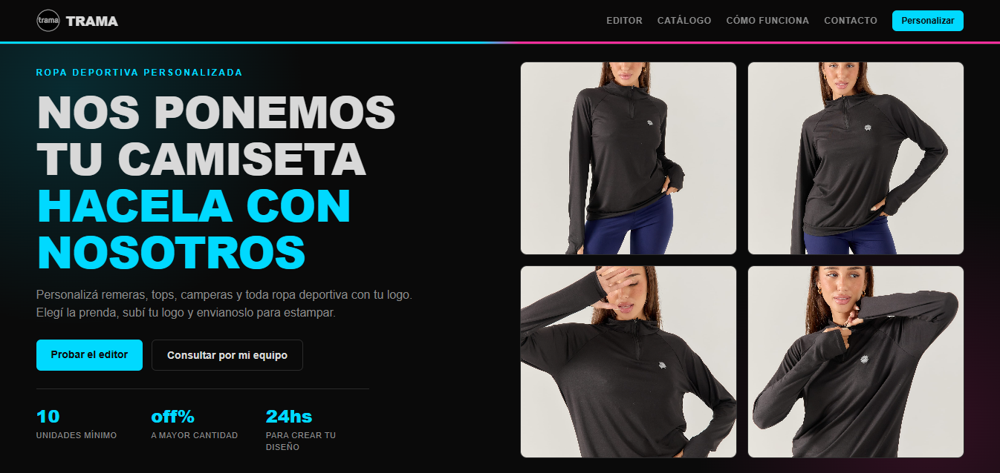
</p>

| Editor | Catálogo |
| --- | --- |
| 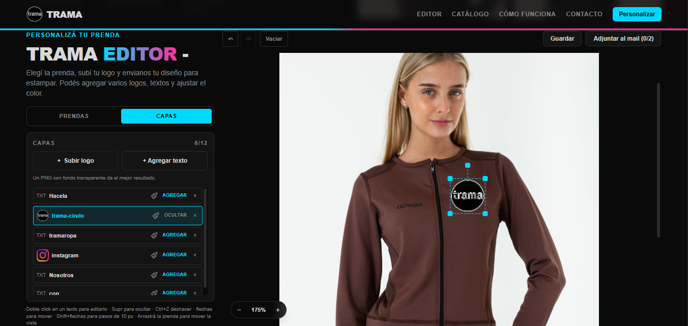 | 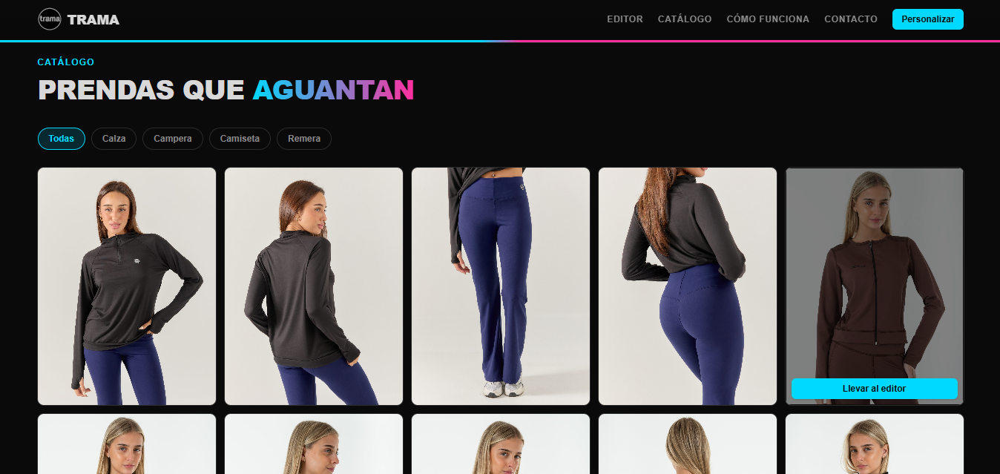 |

| Cómo funciona | Contacto |
| --- | --- |
| 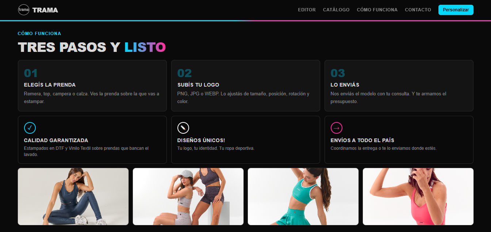 | 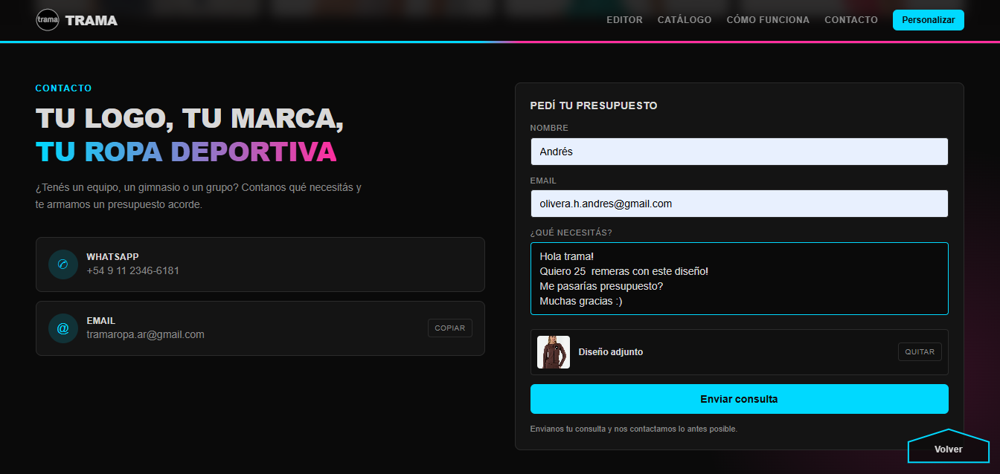 |

<details>
<summary>Panel de administración</summary>

| | |
| --- | --- |
| 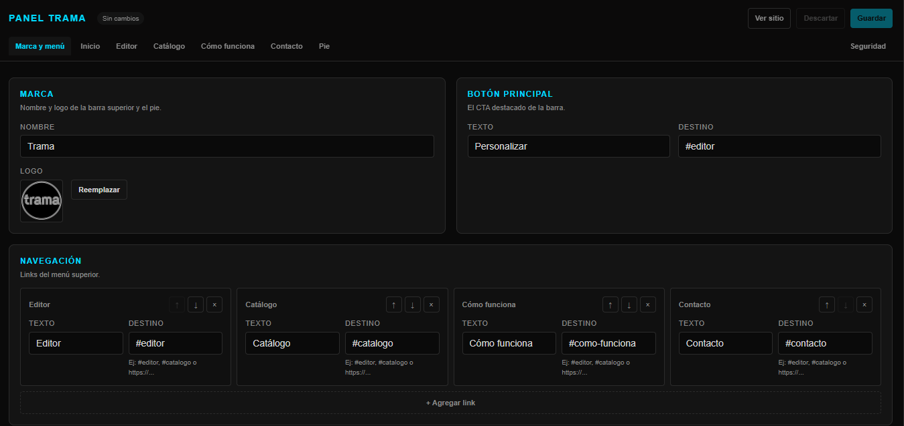 | 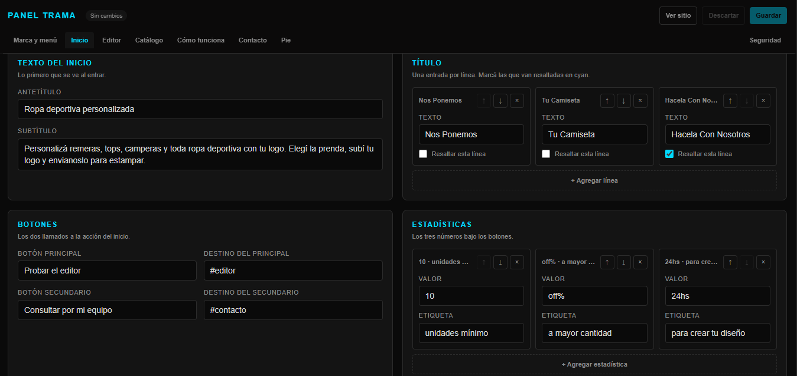 |
| 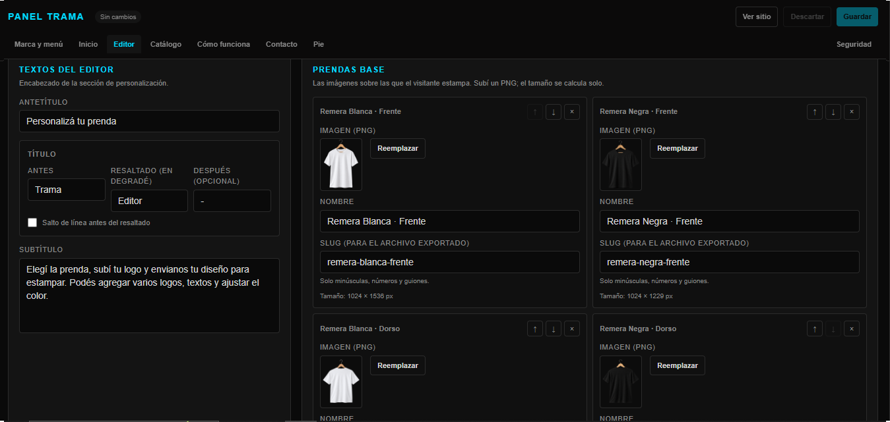 | 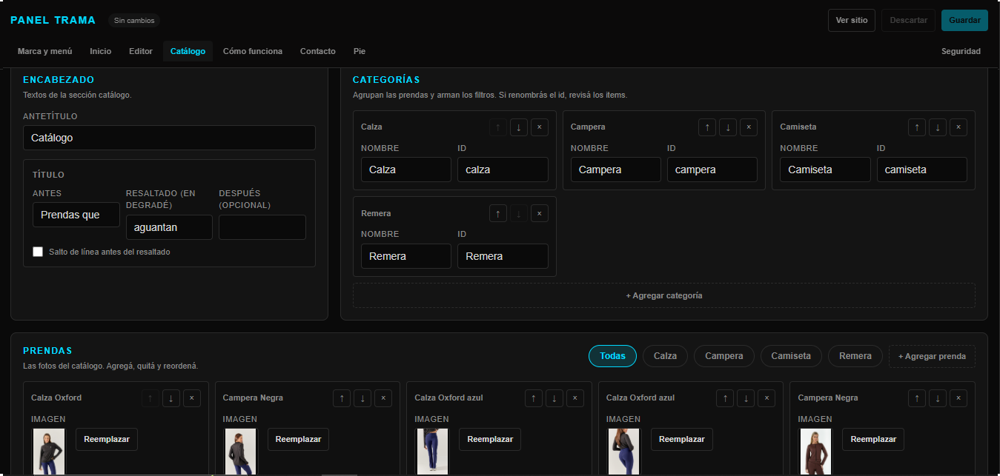 |
| 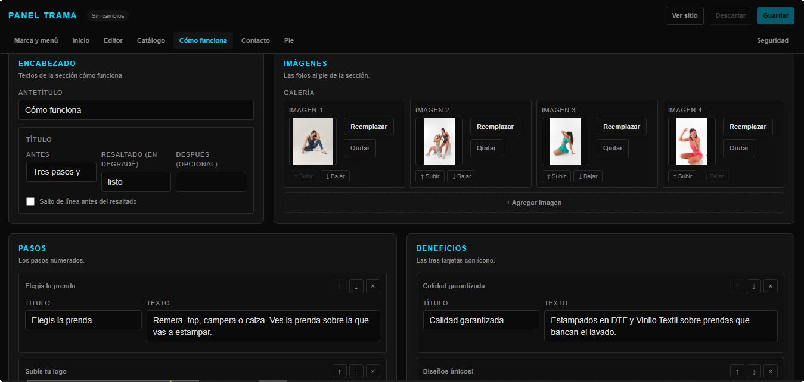 | 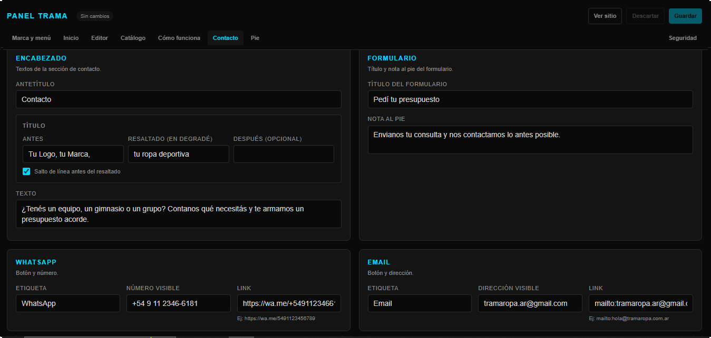 |
| 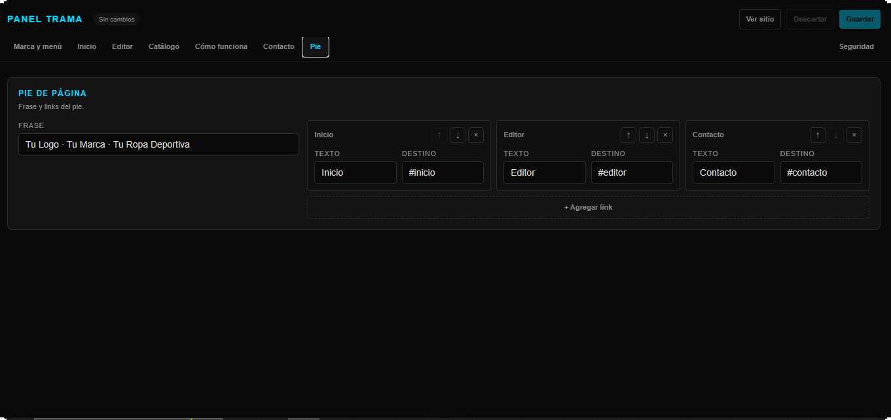 | |

</details>

Las capturas viven en `docs/screenshots/` y quedan fuera de `public/` a propósito, para no enviarlas en el build de producción.

## Funcionalidades

### Landing

- Navegación, inicio, catálogo, pasos de "Cómo funciona", datos de contacto y pie editables desde el contenido.
- Layout responsive con menú de navegación mobile.
- Filtros de catálogo y flujo "llevar al editor" para enviar prendas al espacio de diseño.
- Acciones de contacto por WhatsApp y email, más un formulario opcional con Web3Forms.

### Editor de diseño

- Lienzo Konva para componer logos y texto sobre mockups de prendas.
- Prendas por defecto y prendas del catálogo, con hasta 12 capas por diseño.
- Capas de imagen con subida, filtros, volteo, redimensionado, rotación y control de visibilidad.
- Capas de texto con fuentes del sistema, pesos normal/bold, color y alineación.
- Undo/redo, atajos de teclado, zoom de 100% a 300% y navegación con paneo/scroll.
- Autoguardado, hasta 12 diseños con nombre y flujo "guardar como nuevo".
- Exportación PNG a 3x, disponible para admins logueados.
- Adjuntar hasta dos diseños al formulario de contacto cuando Supabase está configurado.

### Panel de administración

- Siete paneles de contenido: marca y navegación, inicio, editor, catálogo, cómo funciona, contacto y pie.
- Edición basada en draft con acciones de guardar y descartar.
- Subida y reemplazo de imágenes, listas repetibles, reordenamiento y controles por sección.
- Autenticación por contraseña con Supabase Auth cuando está configurado, o un candado local del navegador en caso contrario.
- Acción de descarga visible sólo para admins en el editor.
- Layout ancho del dashboard con fallback responsive apilado.

### Datos y multimedia

- Persistencia local-first por defecto: contenido en `localStorage`, blobs de media en IndexedDB.
- Persistencia opcional en Supabase para contenido y media subida.
- Los diseños del editor siguen siendo locales al navegador en ambos modos.
- Los valores por defecto y la lógica de merge mantienen el sitio usable cuando faltan datos guardados o están incompletos.
- La limpieza de blobs elimina la media que ya no referencian el contenido ni los diseños guardados.

## Stack técnico

- **Vite 8** + **React 19** + **TypeScript 5.9** en modo strict.
- **Tailwind CSS 4** para estilos y tokens de diseño.
- **Konva / react-konva 10** para el lienzo del editor.
- **react-router-dom 7** para `/` y `/admin`.
- **idb-keyval** para el almacenamiento de media en IndexedDB.
- **Supabase JS** para contenido, media y autenticación opcionales.
- **sharp** para el script de optimización de assets.
- **Vitest** + Testing Library para los tests.

## Arquitectura

```text
src/
  admin/       dashboard /admin: auth, estado de draft, campos y paneles por sección
  components/  secciones de la landing y UI del editor
  content/     modelo de contenido, defaults, store, drivers y resolución de imágenes
  data/        prendas por defecto del editor
  lib/         estado del editor, métricas del canvas, export, storage y helpers de imágenes
  types.ts     tipos del editor (Layer, Design, ProductView)
docs/
  screenshots/ capturas del README
public/
  brand/       assets de marca
  gallery/     imágenes locales del catálogo
  products/    mockups de prendas por defecto
scripts/
  optimize-assets.mjs
```

El seam de datos es deliberadamente pequeño:

- `src/content/store.ts` expone operaciones asíncronas `loadContent`, `saveContent`, `resetContent` y de media.
- `src/admin/useAuth.ts` expone la misma interfaz de autenticación para los modos local y Supabase.
- `src/content/drivers/local.ts` usa `localStorage` + IndexedDB.
- `src/content/drivers/supabase.ts` usa la tabla `site_content` y el bucket público `media` de Storage.
- El SDK de Supabase se importa de forma dinámica, así el modo local nunca lo carga.

## Puesta en marcha

### Requisitos

- Node.js `>=20.19.0`
- npm

### Instalación

```bash
npm install
npm run dev
```

El servidor de desarrollo corre en `http://localhost:5173`.

Para habilitar Supabase o el formulario de contacto, copiá el archivo de ejemplo y completá los valores:

```bash
cp .env.example .env.local
```

### Acceso al panel de administración

1. Levantá la app.
2. Entrá a `http://localhost:5173/admin`.
3. En modo local, la contraseña inicial es `trama`. Cambiala desde la sección **Seguridad**.
4. Con Supabase configurado, iniciá sesión con la contraseña de `VITE_ADMIN_EMAIL`.

> El candado local del admin es sólo un bloqueo del lado del navegador (hash SHA-256 en `localStorage`). No es seguridad real. Usá Supabase Auth para un admin desplegado y protegido.

## Variables de entorno

| Variable | Requerida | Propósito |
| --- | --- | --- |
| `VITE_SUPABASE_URL` | No | Project URL de Supabase, sin `/rest/v1` ni barra final. |
| `VITE_SUPABASE_ANON_KEY` | No | Anon key pública de Supabase usada por el cliente del navegador. |
| `VITE_ADMIN_EMAIL` | Con Supabase | Email fijo de la única cuenta admin. El login sólo pide la contraseña. |
| `VITE_CONTACT_ACCESS_KEY` | No | Access key pública de Web3Forms para el formulario de contacto. |

Sin las variables de Supabase, la app corre en modo local-first. Todas las `VITE_*` se incluyen en el build, así que los cambios requieren un nuevo despliegue.

## Modos de datos

### Local-first

- El contenido se guarda en `localStorage`.
- La media subida y los logos del editor se guardan en IndexedDB.
- Los diseños guardados quedan en el navegador.
- No requiere backend ni credenciales.
- Es el modo por defecto para desarrollo y tests.

### Supabase

- El contenido se guarda como JSONB en la tabla `site_content`.
- La media subida se guarda en el bucket público `media` y se referencia por URL pública.
- La autenticación del admin usa Supabase Auth con `VITE_ADMIN_EMAIL`.
- Los diseños adjuntos al formulario de contacto se suben antes de enviar.
- El modo se selecciona automáticamente cuando están presentes las dos variables de Supabase.

## Scripts

| Comando | Descripción |
| --- | --- |
| `npm run dev` | Inicia el servidor de desarrollo de Vite. |
| `npm run build` | Ejecuta `tsc -b` y genera el bundle de producción. |
| `npm run preview` | Sirve el build de producción en `http://localhost:4173`. |
| `npm run lint` | Ejecuta ESLint. |
| `npm test` | Ejecuta la suite de Vitest una vez. |
| `npm run test:watch` | Ejecuta Vitest en modo watch. |
| `npm run assets` | Reoptimiza las imágenes originales hacia `public/`. |
| `npx tsc -b` | Typecheck de la app, la config de node y los tests. |

## Pruebas y calidad

- Los tests usan Vitest y viven junto a los módulos que prueban como `src/**/*.test.ts(x)`.
- Los tests que dependen del DOM optan por jsdom con un comentario `// @vitest-environment jsdom` al inicio del archivo.
- Supabase se desactiva durante los tests para que el resultado sea determinista aunque exista `.env.local`.
- GitHub Actions ejecuta lint, typecheck, tests y build en pushes y pull requests a `main` y `develop`.
- Antes de dar un cambio por terminado, ejecutá:

```bash
npx tsc -b
npm run lint
npm test
npm run build
```

## Despliegue

Es una single-page application. El host debe redirigir las rutas desconocidas a `index.html` para que `/admin` no devuelva un 404 del servidor.

La configuración de Vercel está incluida en `vercel.json`. Importá el repositorio en Vercel, mantené la configuración detectada de Vite (`npm run build`, output `dist`) y agregá las variables de entorno en Production y Preview si hacen falta.

Para la redirección de autenticación de Supabase, configurá la URL desplegada como **Site URL** en el dashboard de Supabase.

## Documentación

- `AGENTS.md` - convenciones de trabajo, comandos y restricciones.
- `MEMORY.md` - decisiones de arquitectura, limitaciones conocidas e historial del proyecto.
