# Trama

**Custom sportswear, a browser-based design editor, and a content admin.**

**English** · [Español](README.es.md)

[](https://github.com/Hector-Olivera/trama-ropa/actions/workflows/ci.yml)


## Overview

Trama is the website for a custom sportswear brand. It combines a commercial landing page with a Konva-powered editor for placing logos and text on garment mockups, plus an `/admin` dashboard for editing site content without touching code.

The product interface is in Spanish. Navigation, hero, catalog, steps, contact details, and footer are all content-driven: they live in a typed content model and can be edited from the admin.

## Screenshots

<p align="center">
  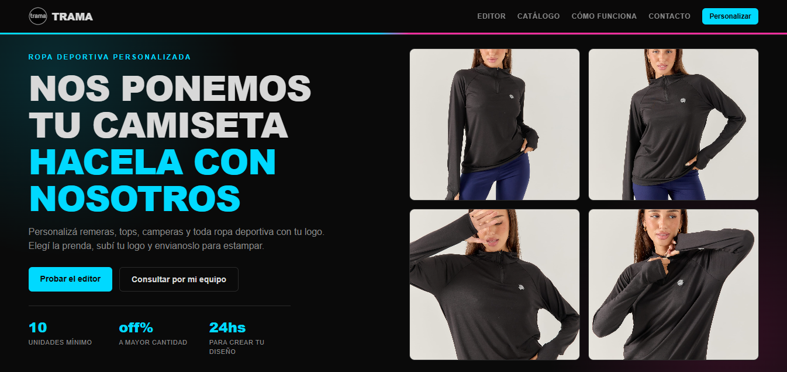
</p>

| Editor | Catalog |
| --- | --- |
| 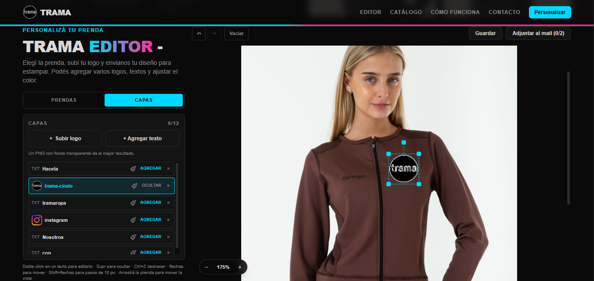 | 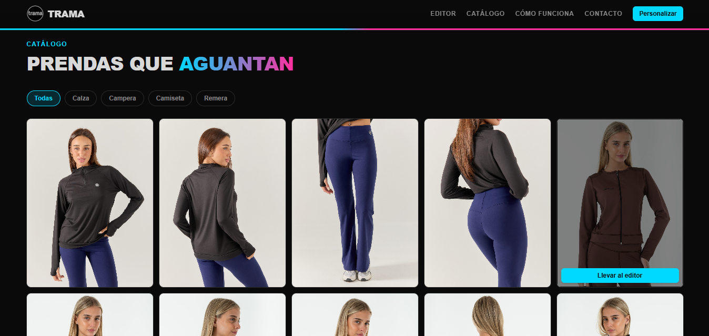 |

| How it works | Contact |
| --- | --- |
| 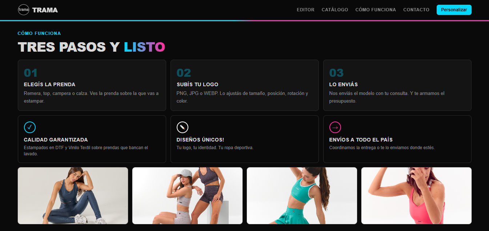 | 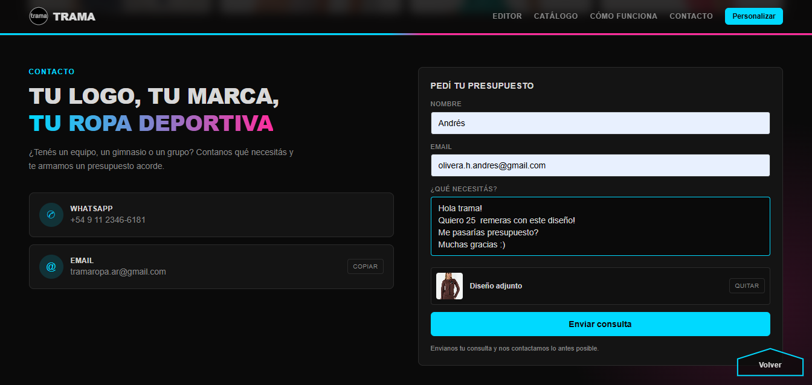 |

<details>
<summary>Admin dashboard</summary>

| | |
| --- | --- |
| 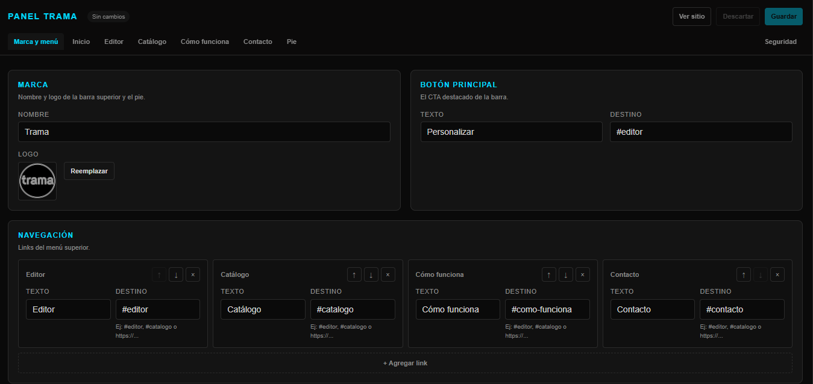 | 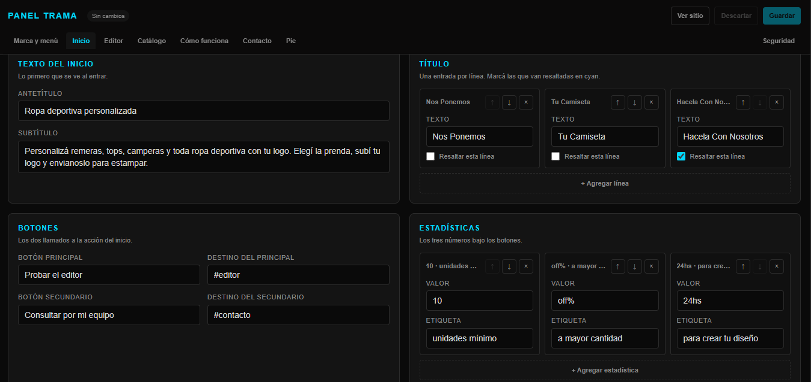 |
| 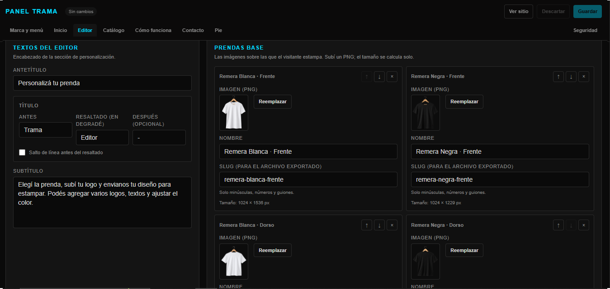 | 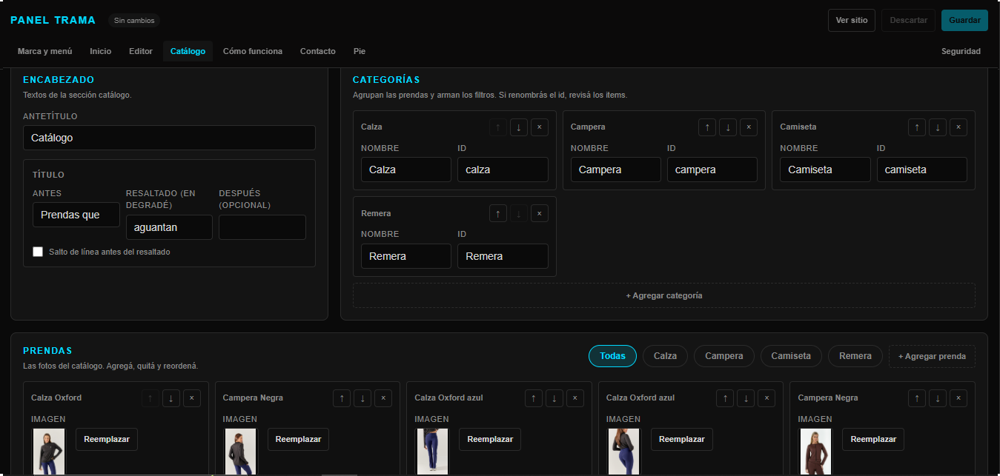 |
| 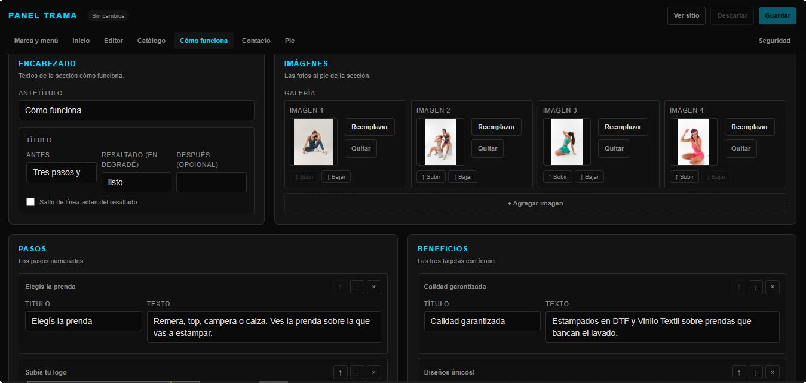 | 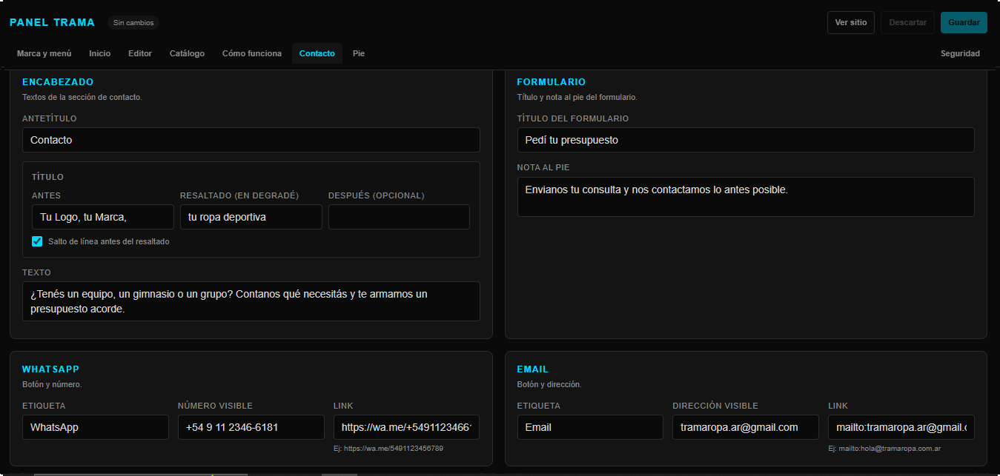 |
| 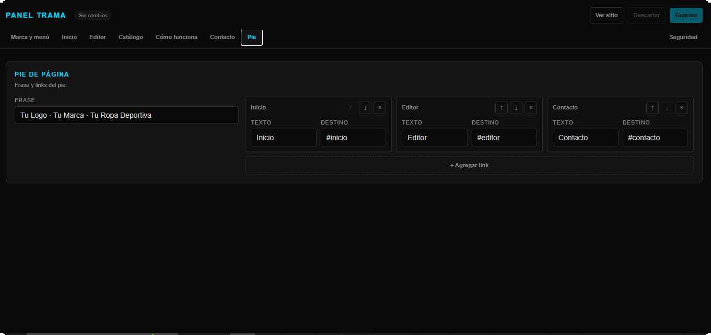 | |

</details>

The screenshots live in `docs/screenshots/` and are intentionally outside `public/`, so they are not shipped in the production build.

## Features

### Landing page

- Content-driven navigation, hero, product catalog, how-it-works steps, contact details, and footer.
- Responsive layout with a mobile navigation menu.
- Catalog filters and a "take to editor" flow that sends garments to the design workspace.
- WhatsApp and email contact actions, plus an optional Web3Forms contact form.

### Design editor

- Konva canvas for composing logos and text over garment mockups.
- Default garments and catalog garments, with up to 12 layers per design.
- Image layers with upload, filters, flipping, resizing, rotation, and visibility controls.
- Text layers with system fonts, normal/bold weights, color, and alignment.
- Undo/redo, keyboard shortcuts, zoom from 100% to 300%, and pan/scroll navigation.
- Autosave, up to 12 named designs, and a "save as new" flow.
- PNG export at 3x resolution, available to logged-in admins.
- Attach up to two designs to the contact form when Supabase is configured.

### Admin dashboard

- Seven content panels: brand and navigation, home, editor, catalog, how it works, contact, and footer.
- Draft-based editing with save and discard actions.
- Image upload and replacement, repeatable lists, reordering, and section-level controls.
- Password authentication with Supabase Auth when configured, or a local browser gate otherwise.
- Admin-only download action in the editor.
- Wide dashboard layout with a responsive stacked fallback.

### Data and media

- Local-first persistence by default: content in `localStorage`, media blobs in IndexedDB.
- Optional Supabase persistence for content and uploaded media.
- Editor designs remain local to the browser in both modes.
- Content defaults and merge logic keep the site usable when stored data is missing or incomplete.
- Blob garbage collection removes media that is no longer referenced by saved content or designs.

## Tech stack

- **Vite 8** + **React 19** + **TypeScript 5.9** in strict mode.
- **Tailwind CSS 4** for styling and design tokens.
- **Konva / react-konva 10** for the editor canvas.
- **react-router-dom 7** for `/` and `/admin`.
- **idb-keyval** for IndexedDB media storage.
- **Supabase JS** for optional content, media, and authentication.
- **sharp** for the asset optimization script.
- **Vitest** + Testing Library for tests.

## Architecture

```text
src/
  admin/       /admin dashboard: auth, draft state, fields, and section panels
  components/  landing sections and editor UI
  content/     content model, defaults, store, drivers, and image resolution
  data/        default garments for the editor
  lib/         editor state, canvas metrics, export, storage, and image helpers
  types.ts     editor types (Layer, Design, ProductView)
docs/
  screenshots/ README captures
public/
  brand/       brand assets
  gallery/     local catalog images
  products/    default garment mockups
scripts/
  optimize-assets.mjs
```

The data seam is deliberately small:

- `src/content/store.ts` exposes asynchronous `loadContent`, `saveContent`, `resetContent`, and media operations.
- `src/admin/useAuth.ts` exposes the same authentication interface for local and Supabase modes.
- `src/content/drivers/local.ts` uses `localStorage` + IndexedDB.
- `src/content/drivers/supabase.ts` uses the `site_content` table and the public `media` Storage bucket.
- The Supabase SDK is imported dynamically, so the local mode never loads it.

## Getting started

### Requirements

- Node.js `>=20.19.0`
- npm

### Installation

```bash
npm install
npm run dev
```

The development server runs at `http://localhost:5173`.

To enable Supabase or the contact form, copy the example environment file and fill in the values:

```bash
cp .env.example .env.local
```

### Admin access

1. Start the app.
2. Open `http://localhost:5173/admin`.
3. In local mode, the initial password is `trama`. Change it from the **Seguridad** section.
4. With Supabase configured, log in with the password for `VITE_ADMIN_EMAIL`.

> The local admin gate is only a browser-side lock (SHA-256 hash stored in `localStorage`). It is not real security. Use Supabase Auth for a deployed, protected admin.

## Environment variables

| Variable | Required | Purpose |
| --- | --- | --- |
| `VITE_SUPABASE_URL` | No | Supabase project URL, without `/rest/v1` or a trailing slash. |
| `VITE_SUPABASE_ANON_KEY` | No | Public Supabase anon key used by the browser client. |
| `VITE_ADMIN_EMAIL` | With Supabase | Fixed email for the single admin account. The login form only asks for the password. |
| `VITE_CONTACT_ACCESS_KEY` | No | Public Web3Forms access key for the contact form. |

Without Supabase variables, the app runs in local-first mode. All `VITE_*` values are embedded at build time, so changes require a new deployment.

## Data modes

### Local-first

- Content is stored in `localStorage`.
- Uploaded media and editor logos are stored in IndexedDB.
- Saved designs stay in the browser.
- No backend or credentials are required.
- This is the default mode for development and tests.

### Supabase

- Content is stored as JSONB in the `site_content` table.
- Uploaded media is stored in the public `media` bucket and referenced by public URL.
- Admin authentication uses Supabase Auth with `VITE_ADMIN_EMAIL`.
- Contact form attachments are uploaded before the form is submitted.
- The mode is selected automatically when both Supabase variables are present.

## Scripts

| Command | Description |
| --- | --- |
| `npm run dev` | Start the Vite development server. |
| `npm run build` | Run `tsc -b` and build the production bundle. |
| `npm run preview` | Serve the production build at `http://localhost:4173`. |
| `npm run lint` | Run ESLint. |
| `npm test` | Run the Vitest suite once. |
| `npm run test:watch` | Run Vitest in watch mode. |
| `npm run assets` | Re-optimize source images into `public/`. |
| `npx tsc -b` | Typecheck the app, node config, and tests. |

## Testing and quality

- Tests use Vitest and live next to the modules they cover as `src/**/*.test.ts(x)`.
- DOM-dependent tests opt into jsdom with a file-level `// @vitest-environment jsdom` comment.
- Supabase is disabled during tests so results are deterministic even when `.env.local` exists.
- GitHub Actions runs lint, typecheck, tests, and build on pushes and pull requests to `main` and `develop`.
- Before shipping a change, run:

```bash
npx tsc -b
npm run lint
npm test
npm run build
```

## Deployment

This is a single-page application. The host must rewrite unknown routes to `index.html` so `/admin` does not return a server-side 404.

Vercel configuration is included in `vercel.json`. Import the repository into Vercel, keep the detected Vite settings (`npm run build`, output `dist`), and add the environment variables in Production and Preview if needed.

For Supabase authentication redirection, set the deployed URL as the Auth **Site URL** in the Supabase dashboard.

## Documentation

- `AGENTS.md` - working conventions, commands, and constraints.
- `MEMORY.md` - architecture decisions, known limitations, and project history.
